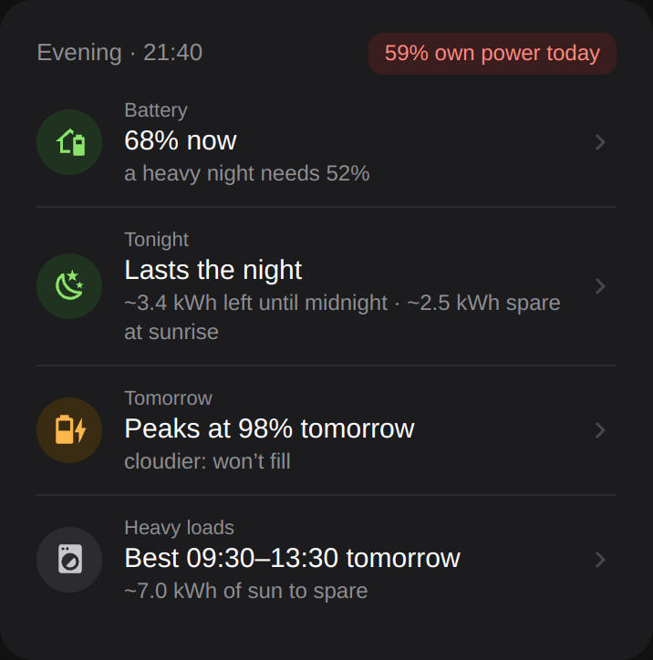
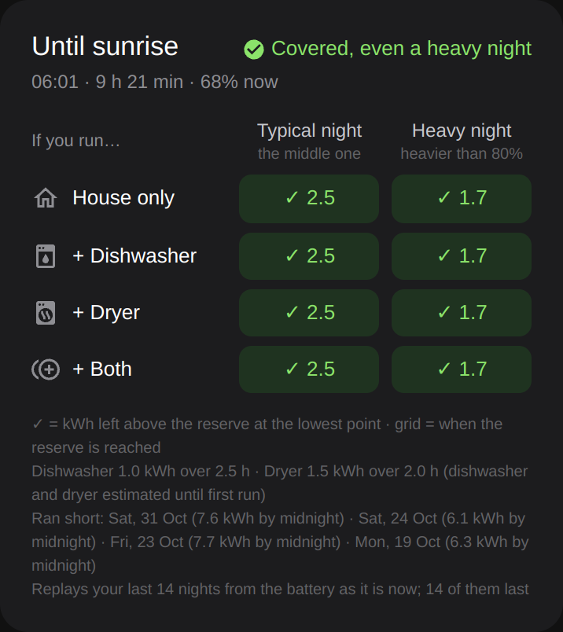
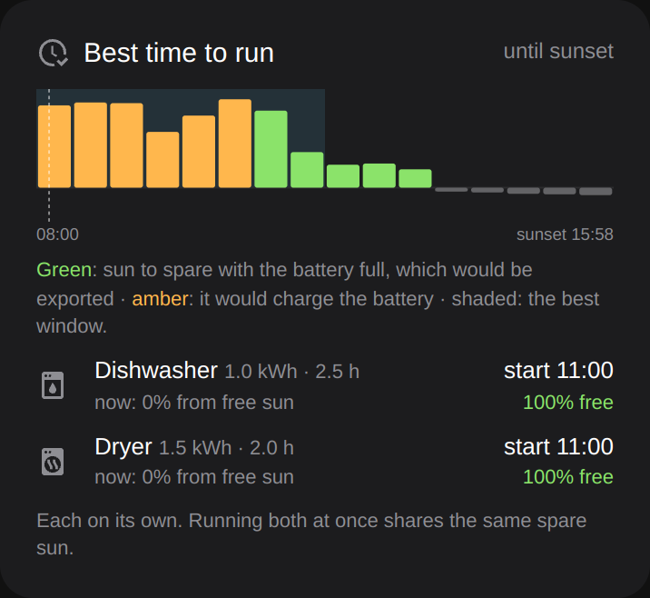
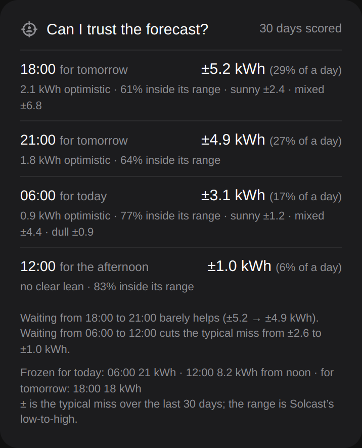
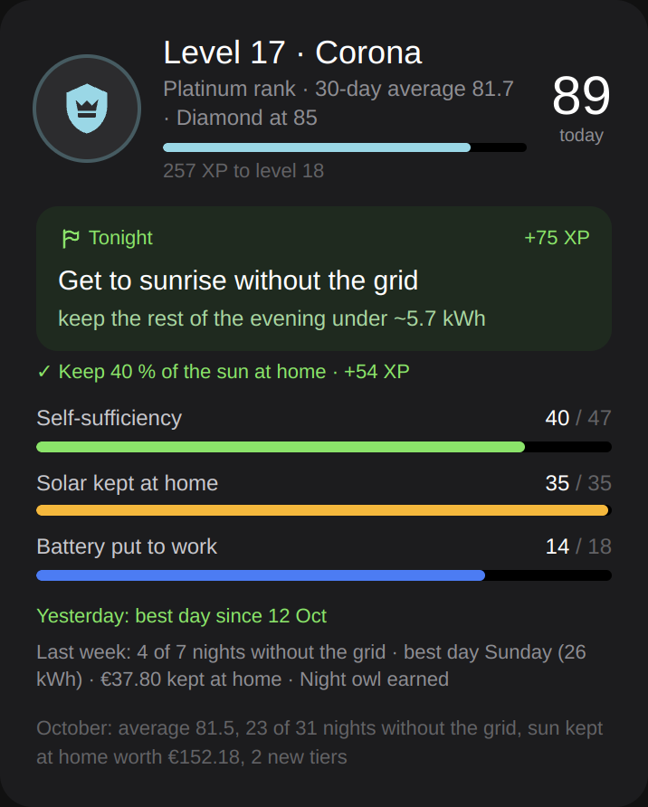
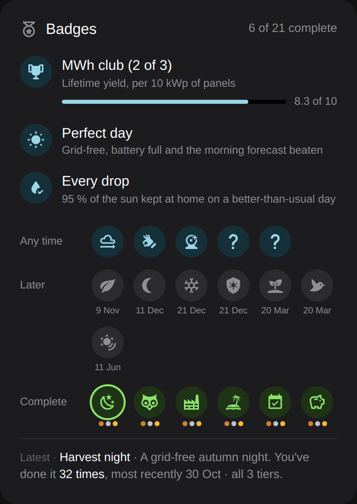

# Solar Energy Insights

> **Alpha.** Built for an EcoFlow PowerOcean read through
> [EF-PowerOcean-TcpModbus](https://github.com/MaxGrmm/EF-PowerOcean-TcpModbus), with Solcast.
> Other batteries may work, but aren't tested.

A Home Assistant integration that turns battery and solar numbers into answers:
will the battery last the night, when to run the dishwasher, and how far to
trust the forecast.

<table>
<tr>
<td></td>
<td></td>
<td></td>
</tr>
<tr>
<td></td>
<td></td>
<td></td>
</tr>
</table>

The top row and the forecast card are from the author's dashboard (built on the
sensors below); only the achievement cards ship with the integration so far.

## What it does

- **Tonight.** Replays your last 14 real nights from the battery as it is now:
  does it last, when does the grid take over, and how much the evening may use.
- **Today.** When the battery will be full, and the best window for heavy loads.
- **The forecast.** Freezes Solcast at 18:00, 21:00, 06:00 and 12:00 and scores
  each against what came, so you know how far to trust it when you decide.
- **Strings.** Energy and yield per kWp for each PowerOcean string.
- **Achievements** (optional). Levels, streaks, records and badges.

It learns from your own history, and only keeps what a backtest shows predicts
better. Everything is a sensor, so it works in automations too.

## Install

1. In HACS, add `https://github.com/windmark/ha-solar-energy-insights` as a
   custom repository (type: Integration) and install it.
2. Restart Home Assistant.
3. **Settings › Devices & services › Add integration › Solar Energy Insights.**
   PowerOcean and Solcast entities are suggested.

Requires Home Assistant 2026.9, the recorder, Solcast PV Forecast and
[EF-PowerOcean-TcpModbus](https://github.com/MaxGrmm/EF-PowerOcean-TcpModbus).

## Cards

The cards ship with the integration:

```yaml
- type: custom:solar-energy-insights-level
- type: custom:solar-energy-insights-streaks
- type: custom:solar-energy-insights-records
- type: custom:solar-energy-insights-badges
```

For your own cards, `sensor.solar_energy_insights_summary` has each tile's
headline and details as attributes.

## More

- [Entities, options and actions](docs/reference.md)
- [How achievements work](docs/achievements.md)

Something looks wrong? Download the diagnostics from the integration's page
and attach them to an issue.
