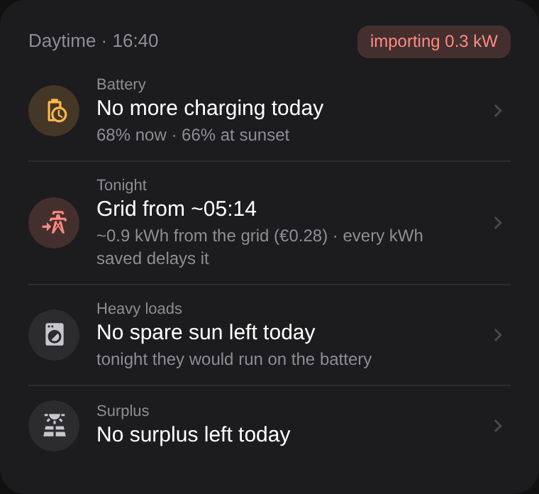
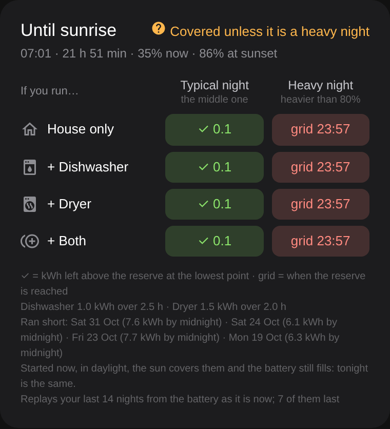
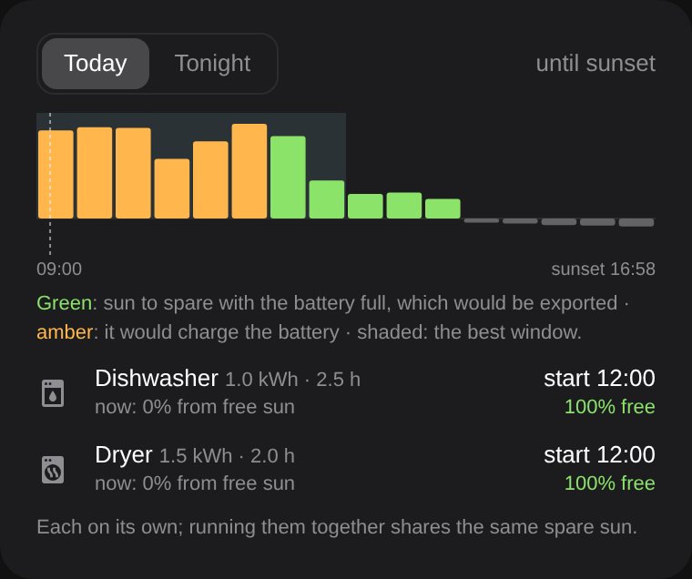
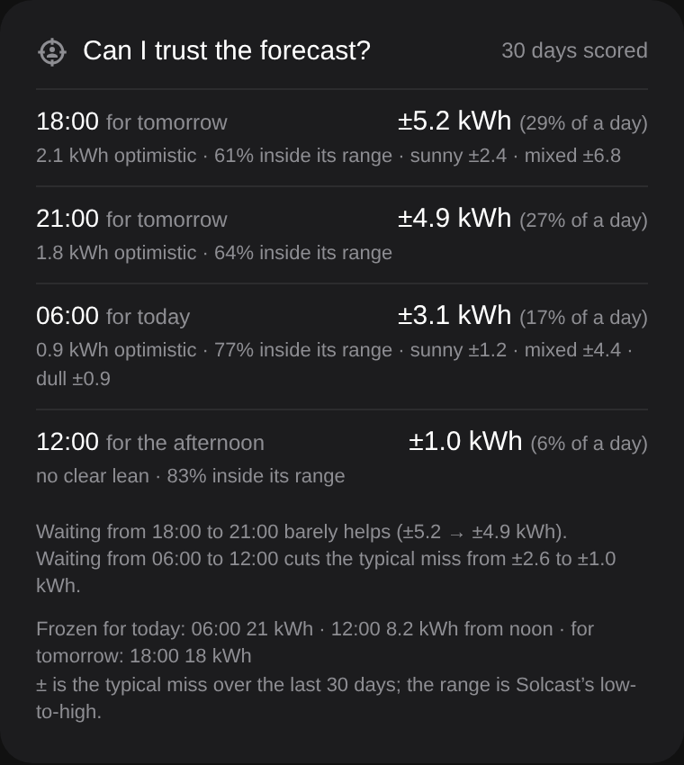
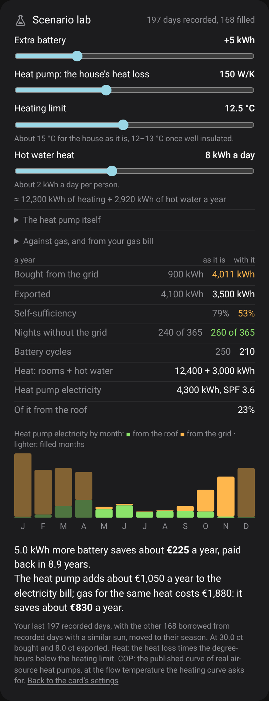
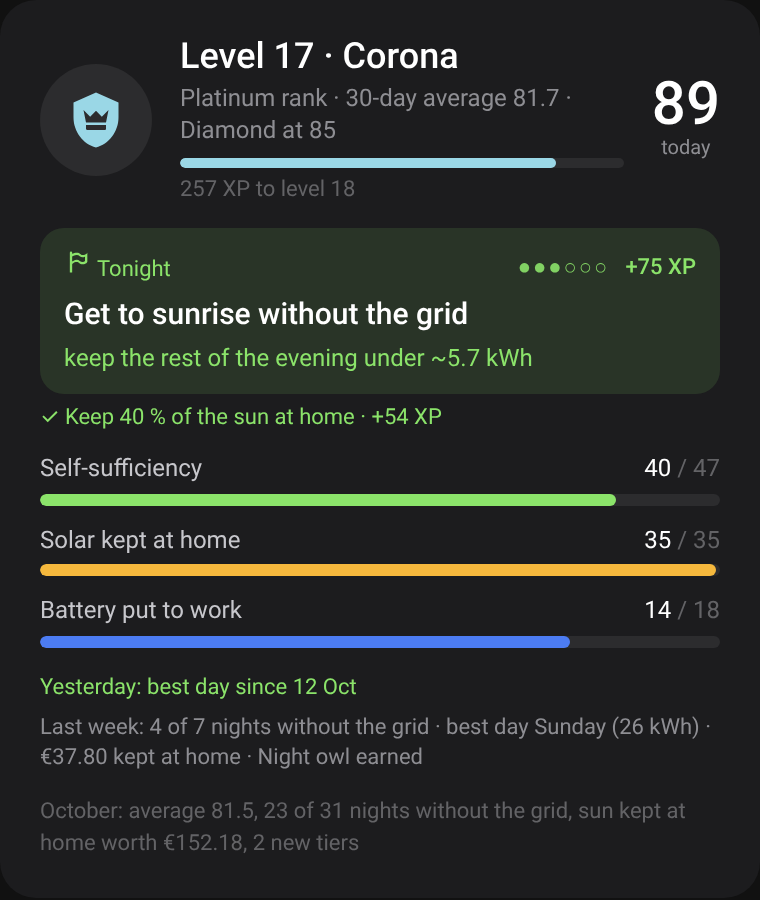

# Solar Energy Insights

> [!NOTE]
> This integration was vibe coded. It's just a fun side project of
> mine to formalize and share my solar tiles and logic.

> **Alpha.** Built for an EcoFlow PowerOcean read through
> [EF-PowerOcean-TcpModbus](https://github.com/MaxGrmm/EF-PowerOcean-TcpModbus), with Solcast.
> Other batteries may work, but aren't tested.

A Home Assistant integration that turns battery and solar numbers into answers:
will the battery last the night, when to run the dishwasher, and how far to
trust the forecast.

<table>
<tr>
<td></td>
<td></td>
<td></td>
</tr>
<tr>
<td></td>
<td></td>
<td></td>
</tr>
</table>

## What it does

- **Tonight.** Replays your last 14 real nights from the battery as it is now:
  does it last, when does the grid take over, and how much the evening may use.
- **Today.** When the battery will be full, and the best window for heavy loads.
- **The forecast.** Freezes Solcast at 18:00, 21:00, 06:00 and 12:00 and scores
  each against what came, so you know how far to trust it when you decide.
- **Strings.** Energy and yield per kWp for each string, adding up to the
  solar counter.
- **Appliances.** When to start the dishwasher on spare sun, and what it leaves
  of the battery tonight, learned from its energy counter.
- **Achievements** (optional). Levels, streaks, records and badges. Badges
  climb ladders of better days, seasonal ones are played against last season,
  and quests follow how you do.

It learns from your own history, and only keeps what a backtest shows predicts
better. Everything is a sensor, so it works in automations too.

## Installation

### Via HACS (recommended)

Or add it from within HACS:

1. Open **HACS** in Home Assistant
2. Open the menu (⋮) › **Custom repositories**
3. Add `https://github.com/windmark/ha-solar-energy-insights` with type **Integration**
4. Search for **Solar Energy Insights**, open it and click **Download**
5. Restart Home Assistant

### Manual

1. Download the repository
2. Copy the `custom_components/solar_energy_insights` folder to your HA `config/custom_components/` directory
3. Restart Home Assistant

### Setup

Or **Settings › Devices & services › Add integration › Solar Energy Insights**.
PowerOcean and Solcast entities are suggested.

Requires Home Assistant 2026.9, the recorder, Solcast PV Forecast and
[EF-PowerOcean-TcpModbus](https://github.com/MaxGrmm/EF-PowerOcean-TcpModbus).

## Cards

The cards ship with the integration. Open a dashboard, choose
**Edit dashboard › Add card** and search for **Solar**: each card previews with
your own data and has its settings in the visual editor.

| Card                                           | Answers                                                   |
| ---------------------------------------------- | --------------------------------------------------------- |
| Solar now                                      | How does today look, from the battery to tonight?         |
| Until sunrise                                  | Will the battery last the night, and with the dishwasher? |
| Best time to run                               | When should I start my appliances today?                  |
| Appliances                                     | Both of the above in one card                             |
| Can I trust the forecast?                      | How far off is Solcast, usually?                          |
| Scenario lab                                   | Would a bigger battery or a heat pump pay?                |
| Solar moments, level, streaks, records, badges | Achievements, if turned on                                |

[Every card, its settings and its YAML](docs/cards.md).

Add your appliances under the integration (**Add appliance** on its page), with
their energy counters: the cards show them, and each gets sensors for
automations. For cards of your own, `sensor.solar_energy_insights_summary` has
each row's headline and details as attributes.

## More

- [The cards: what each shows, its settings and YAML](docs/cards.md)
- [Entities, options and actions](docs/reference.md)
- [How achievements work](docs/achievements.md)

Something looks wrong? Download the diagnostics from the integration's page
and attach them to an issue.
