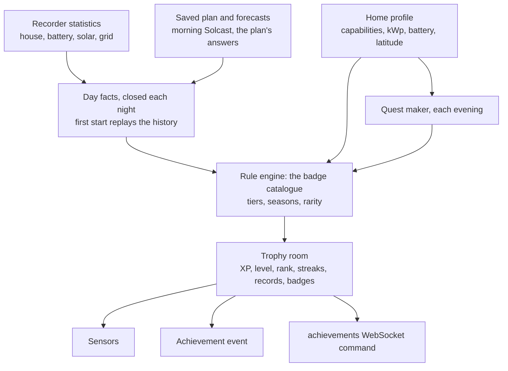

# Solar achievements: design

Design for the achievements extension of Solar Energy Insights, written 31 October 2026. The living version of this document is a Claude Doc; this copy travels with the code. The section [As built](#as-built) records where the implementation differs.

## Summary

Achievements become an optional part of Solar Energy Insights: switched on in the options, with no setup of their own. They are computed from the recorder after each day closes. Three ideas make them fun and portable:

1. **Earned from history, from day one.** On first start the integration replays every day the recorder holds, so a new user opens a trophy room that is already partly filled, not an empty one.
2. **Relative to your own home.** Thresholds are set against your array's size, your battery and your own past days, so a 4 kWp flat in Hamburg and a 15 kWp house in Seville earn badges at a similar pace.
3. **Alive, not a checklist.** Daily and weekly quests are drawn from tomorrow's forecast and the plan. Badges have seasons that follow your hemisphere, some are hidden until earned, and each has a rarity measured in your own days.

The Achievements view keeps its look. Its template sensor and the JavaScript that feeds it go away.

## What existed, and what to keep

| Card    | What it did                                                                                                                                                                                                                                 | What changes                                                                                                    |
| ------- | ------------------------------------------------------------------------------------------------------------------------------------------------------------------------------------------------------------------------------------------- | --------------------------------------------------------------------------------------------------------------- |
| Level   | A daily score out of 100: self-sufficiency 40, solar kept at home 30, battery put to work 15, performance against the 06:00 forecast 15. XP adds up the scores; levels need 50·L·(L+1) XP. Rank (Bronze to Diamond) from the 30-day average | The same score, computed by the integration from closed days. The forecast part uses the saved morning forecast |
| Streaks | Self-sufficient, battery filled, beat the forecast, grid-free nights; current and best                                                                                                                                                      | Kept, plus a streak shield so one storm does not undo a month                                                   |
| Records | Best day, peak power, most exported, longest off-grid, earliest full, thriftiest day; live chase bar                                                                                                                                        | Kept, plus the date and a "top x % of your days" label                                                          |
| Badges  | 14 seasonal badges in three tiers, thresholds fixed for one 15 kWp roof in Bavaria; two milestones                                                                                                                                          | Thresholds relative to the home; seasons by hemisphere; hidden badges; rarity; badges tied to the plan's advice |

## Principles

- **Closed days only.** A day is judged after it ends, from the recorder's statistics. Nothing is awarded on a live reading that a glitch could fake, and the same history always gives the same trophies.
- **Recomputable.** The trophy room is a function of the history plus the rules, so changing a rule or fixing a bug replays it.
- **Nothing to configure.** Everything is derived from entities the integration has. A badge whose data is missing is not shown, rather than shown as impossible.
- **Fair across homes.** Every threshold is relative to the home: per kWp of panels, per kWh of battery, or a percentile of your own days.
- **Encourage good decisions, not more consumption.** Rewards go to using your own sun, lasting the night and following the plan's advice.
- **Local and private.** No cloud and no leaderboard of strangers.

## How it generalizes

Each badge is a rule over day facts, declared as data with what it needs and how its threshold scales.

**1. Capabilities decide what is offered.**

| Capability  | Comes from                                       | Unlocks                                              |
| ----------- | ------------------------------------------------ | ---------------------------------------------------- |
| Battery     | State of charge and capacity (always configured) | Full battery, grid-free night, cycles                |
| House use   | House energy counter (always configured)         | Thriftiest day, thrifty week                         |
| Solar yield | Optional solar energy counter                    | Yield, specific yield, beat the forecast, records    |
| Grid flows  | Optional grid import and export counters         | Self-sufficiency, solar kept at home, off-grid hours |
| Forecast    | The saved morning Solcast forecast               | Beat the forecast, silver lining, perfect day        |
| Advice      | The plan's own saved answers                     | Steady hand, forecast whisperer                      |
| Seasons     | Latitude at least 15° from the equator           | Every seasonal badge                                 |

**2. Thresholds scale with the system.** Energy is measured per kWp of panels and per kWh of battery. Array size is learned from the history: the 99th percentile of the best hour's yield, divided by 0.85.

**3. Difficulty comes from your own days.** Thresholds that describe a good day are percentiles of the days before the one judged. Rarity is the share of your days that earned a badge: common, rare (under 10 %) or legendary (under 2 %).

**4. Seasons follow your sky.** Seasons come from the latitude in Home Assistant, with astronomical dates, so winter badges appear in July in Melbourne. Near the equator, seasonal badges are not offered.

## Day facts

Every closed day is reduced to one record of facts; every rule reads only that record and the ones before it.

| Fact                                         | From                                                                                                                                                        |
| -------------------------------------------- | ----------------------------------------------------------------------------------------------------------------------------------------------------------- |
| Solar yield, best hour                       | Solar energy counter, hourly change                                                                                                                         |
| House use                                    | House energy counter                                                                                                                                        |
| Grid import and export, off-grid hours       | Import and export counters; an hour under 20 Wh imported is off the grid                                                                                    |
| Battery highest and lowest, when it got full | State of charge: 5-minute statistics where kept, else hourly; full means reaching the charge limit; readings below the floor are cleaned as in the backtest |
| Night outcome                                | The same evening (21:00 to sunrise) the backtest uses                                                                                                       |
| Morning forecast                             | The integration's saved morning Solcast forecast                                                                                                            |
| Peak solar power                             | Solar power, hourly maximum                                                                                                                                 |
| What the plan said                           | The saved "full at" each morning and the outlook at 21:00                                                                                                   |

Facts are kept in the integration's store, about 1 kB a day.

## The game

**Daily score (0–100).** Self-sufficiency 40, solar kept at home 30, battery put to work 15, performance against the morning forecast 15. Parts a home cannot measure are dropped and the rest rescaled to 100. A live "today so far" score shows during the day.

**XP, levels and ranks.** XP is the sum of daily scores, plus 50, 100 and 200 for each bronze, silver and gold tier, plus quest rewards. Levels keep the curve 50·L·(L+1) and gain names, a new one every three levels: Spark, Glow, Sunbeam, Photon, Flare, Corona, Solstice, Zenith, then Zenith II and up. Rank comes from the 30-day average; in a season whose days score lower than your year as a whole, the cut-offs come down with it.

**Streaks, with a shield.** Each 7-day run earns a shield (two at most) that absorbs one break caused by weather: a day whose morning forecast was among the gloomiest 20 % of its season.

**Records.** Each with its date, the season's best, and how the latest day ranked among all your days.

**Quests.** Each evening from 20:00, one quest for the next day; on Mondays, one for the week. Targets come from your own days with a similar forecast, set so about three in five would have met them. A borderline night ahead comes first: "Get to sunrise without the grid". Quests pay 25–100 XP by difficulty; missing one costs nothing.

**Recaps and moments.** Earning a tier, breaking a record, levelling up, completing a quest and closing a month fire `solar_energy_insights_achievement` with a title and a ready-made message.

## Badge catalogue

| Badge                    | Season      | Earned on a day when                                                        | Tiers           | Needs                          |
| ------------------------ | ----------- | --------------------------------------------------------------------------- | --------------- | ------------------------------ |
| Perfect day              | Any         | Grid-free, battery full, and the morning forecast beaten                    | 1 · 5 · 20      | Battery, grid, solar, forecast |
| Every drop               | Any         | 95 % of the sun kept at home on a day at or above your median yield per kWp | 1 · 5 · 15      | Solar, grid                    |
| Power plant              | Any         | Export at least 2 kWh per kWp                                               | 1 · 10 · 30     | Solar, grid                    |
| Off-grid week            | Any         | 7 days in a row at least 95 % self-sufficient                               | 1 · 3 · 6 runs  | Grid                           |
| Silver lining            | Any         | 1.5× a forecast among your gloomiest 20 % for the season                    | 1 · 5 · 15      | Solar, forecast                |
| Harvest night            | Autumn      | A grid-free night                                                           | 1 · 10 · 30     | Battery                        |
| Last light               | Late autumn | Battery full in the six weeks before the winter solstice                    | 1 · 10 · 25     | Battery                        |
| Low-sun hero             | Winter      | Yield per kWp in your top 10 % of winter days                               | 1 · 3 · 8       | Solar                          |
| Longest night            | Midwinter   | A grid-free night within ten days of the winter solstice                    | 1 · 3 · 7       | Battery                        |
| Winter warrior           | Winter      | At least 80 % self-sufficient                                               | 1 · 10 · 30     | Grid                           |
| Spring awakening         | Spring      | A grid-free spring day, counted once a year                                 | 1 · 3 · 5 years | Grid                           |
| Early bird               | Spring      | Battery full earlier than four in five of your days                         | 1 · 10 · 30     | Battery                        |
| Midsummer                | Midsummer   | Yield per kWp in your top 5 %, within ten days of the summer solstice       | 1 · 3 · 7       | Solar                          |
| Island mode              | Summer      | 24 hours without the grid                                                   | 1 · 5 · 15      | Grid                           |
| Steady hand              | Any         | A night the plan called borderline that lasted                              | 1 · 5 · 15      | Advice, battery                |
| Forecast whisperer       | Any         | The morning's "full at" within 15 minutes of the real time                  | 1 · 10 · 30     | Advice, battery                |
| Thrifty week             | Any         | A week's house use in your bottom 10 % for the season                       | 1 · 3 · 6 weeks | House use                      |
| Night owl (hidden)       | Any         | A grid-free night after one of your dullest 10 % of days                    | 1               | Battery, solar                 |
| Photo finish (hidden)    | Any         | A night that lasted with under 1 % of the battery to spare                  | 1               | Battery                        |
| Equinox (hidden)         | Equinoxes   | Half the day's use from the sun, within 2 points                            | 1               | Grid                           |
| MWh club (milestone)     | Lifetime    | Lifetime yield per 10 kWp of panels                                         | 1 · 5 · 10 MWh  | Solar                          |
| Cycle master (milestone) | Lifetime    | Full battery cycles, as the battery counts them                             | 100 · 250 · 500 | Battery cycle count            |

Hidden badges show a riddle until earned.

## Architecture

- `core/achievements/`: plain Python, no Home Assistant. `facts.py`, `profile.py`, `game.py` (score, levels, ranks, streaks, records), `badges.py`, `quests.py`, `trophies.py`.
- `achievements.py`: reads the recorder, keeps the facts and quests in the store, computes the room off the event loop, and announces what is new.

| Exposed                                        | What                                                                                                                  |
| ---------------------------------------------- | --------------------------------------------------------------------------------------------------------------------- |
| Sensors                                        | Solar score today (live), level, rank, the four streaks, the quest                                                    |
| Event `solar_energy_insights_achievement`      | `kind` (level, badge, record, quest, recap), `title`, `message`, `icon`                                               |
| WebSocket `solar_energy_insights/achievements` | The whole room: today, level, rank, streaks, records, badges with rarity and riddles, quests, monthly recaps, profile |
| Diagnostics                                    | Days of facts, quests, and the room                                                                                   |

## As built

- **Switched on in the options**, off by default. Extra optional counters in the options (grid import and export, solar power) unlock more; PowerOcean's are suggested.
- **The first start replays up to 400 days**, and announces nothing for them: the room is already earned. Closed days are rebuilt three days back each day, since a night's outcome is only known the next morning.
- **Tiers count earning days**, as the catalogue says; the percentile thresholds decide whether a day earns, from the days before it only.
- **Quests too easy are set aside.** A measure at its ceiling (100 % self-sufficient on most sunny days) would make a quest most similar days meet anyway; options met on more than 80 % of similar days are skipped, falling back to the hardest.
- **Counter jumps are dropped.** A counter that first reports 0 and then its lifetime total makes the recorder count the total as one hour. Hours above both 25 kWh and ten times the counter's typical hour are dropped before anything is learned; stored facts carry a version and are rebuilt quietly when it changes.
- **Cycles come from the battery.** "Cycle master" reads an optional cycle counter and is not offered without one.
- **Money in recaps** uses the integration's prices: sun kept at home at the electricity price, export at the feed-in tariff.
- **A blueprint** (`blueprints/automation/solar_energy_insights/announce_achievements.yaml`) announces chosen kinds on a phone.
- **Not built yet:** Sun chaser (needs appliance runs from plugs) and the yearly "Wrapped" card.

## Open questions

- Should the score's performance part use the forecast corrected for your roof once that correction is in use?
- Is the weather shield too generous?
- Which events should notify by default?
