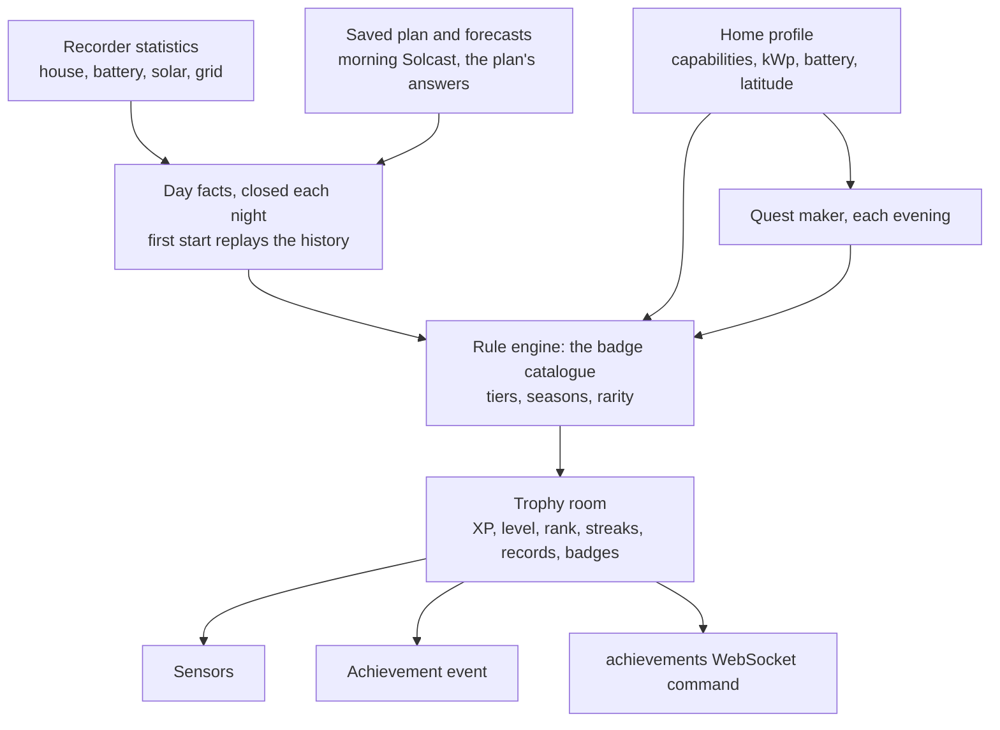

# Solar achievements: design

Design for the achievements extension of Solar Energy Insights, written 31 October 2026. The living version of this document is a Claude Doc; this copy travels with the code. The section [As built](#as-built) records where the implementation differs.

## Summary

Achievements become an optional part of Solar Energy Insights: switched on in the options, with no setup of their own. They are computed from the recorder after each day closes. Three ideas make them fun and portable:

1. **Earned from history, from day one.** On first start the integration replays every day the recorder holds, so a new user opens a trophy room that is already partly filled, not an empty one.
2. **Relative to your own home.** Thresholds are set against your array's size, your battery and your own past days, so a 4 kWp flat in Hamburg and a 15 kWp house in Seville earn badges at a similar pace.
3. **Alive, not a checklist.** Daily and weekly quests are drawn from tomorrow's forecast and the plan. Badges have seasons that follow your hemisphere, some are hidden until earned, and each has a rarity measured in your own days.
4. **Harder as you go.** Each tier of a badge asks for a better day than the one before, not just more of the same. Seasonal badges are played in editions, one per season, each against last year's. A complete badge can unlock a harder one.

The Achievements view keeps its look. Its template sensor and the JavaScript that feeds it go away.

## What existed, and what to keep

| Card    | What it did                                                                                                                                                                                                                                 | What changes                                                                                                    |
| ------- | ------------------------------------------------------------------------------------------------------------------------------------------------------------------------------------------------------------------------------------------- | --------------------------------------------------------------------------------------------------------------- |
| Level   | A daily score out of 100: self-sufficiency 40, solar kept at home 30, battery put to work 15, performance against the 06:00 forecast 15. XP adds up the scores; levels need 50·L·(L+1) XP. Rank (Bronze to Diamond) from the 30-day average | The same score, computed by the integration from closed days. The forecast part uses the saved morning forecast |
| Streaks | Self-sufficient, battery filled, beat the forecast, grid-free nights; current and best                                                                                                                                                      | Kept, plus a streak shield so one storm does not undo a month                                                   |
| Records | Best day, peak power, most exported, longest off-grid, earliest full, thriftiest day; live chase bar                                                                                                                                        | Kept, plus the date and a "top x % of your days" label                                                          |
| Badges  | 14 seasonal badges in three tiers, thresholds fixed for one 15 kWp roof in Bavaria; two milestones                                                                                                                                          | Thresholds relative to the home; seasons by hemisphere; hidden badges; rarity; badges tied to the plan's advice |

## Principles

- **Closed days only.** A day is judged after it ends, from the recorder's statistics. Nothing is awarded on a live reading that a glitch could fake, and the same history always gives the same trophies.
- **Recomputable.** The trophy room is a function of the history plus the rules, so changing a rule or fixing a bug replays it.
- **Nothing to configure.** Everything is derived from entities the integration has. A badge whose data is missing is not shown, rather than shown as impossible.
- **Fair across homes.** Every threshold is relative to the home: per kWp of panels, per kWh of battery, or a percentile of your own days.
- **Encourage good decisions, not more consumption.** Rewards go to using your own sun, lasting the night and following the plan's advice.
- **Local and private.** No cloud and no leaderboard of strangers.

## How it generalizes

Each badge is a rule over day facts, declared as data with what it needs and how its threshold scales.

**1. Capabilities decide what is offered.**

| Capability  | Comes from                                       | Unlocks                                              |
| ----------- | ------------------------------------------------ | ---------------------------------------------------- |
| Battery     | State of charge and capacity (always configured) | Full battery, grid-free night                        |
| House use   | House energy counter (always configured)         | Thriftiest day, thrifty week                         |
| Solar yield | Optional solar energy counter                    | Yield, specific yield, beat the forecast, records    |
| Grid flows  | Optional grid import and export counters         | Self-sufficiency, solar kept at home, off-grid hours |
| Forecast    | The saved morning Solcast forecast               | Beat the forecast, silver lining, perfect day        |
| Advice      | The plan's own saved answers                     | Steady hand, forecast whisperer                      |
| Seasons     | Latitude at least 15° from the equator           | Every seasonal badge                                 |

**2. Thresholds scale with the system.** Energy is measured per kWp of panels and per kWh of battery. The array's size is read from Solcast's rooftop sites, never guessed; badges ranking days against your own history need no size at all. Absolute per-kWp thresholds (Power plant, MWh club) scale with the array's relative yield: a sun model over a year gives each plane's yield against the best plane at your latitude, so an east–west roof (about 0.81) earns them at its own pace. Without a known size, those two badges are not offered.

**3. Difficulty comes from your own days.** Thresholds that describe a good day are percentiles of the days before the one judged. Rarity is the share of your days that earned a badge: common, rare (under 10 %) or legendary (under 2 %).

**4. Seasons follow your sky.** Seasons come from the latitude in Home Assistant, with astronomical dates, so winter badges appear in July in Melbourne. Near the equator, seasonal badges are not offered.

**5. Fair to the sky you had.** Where Solcast's rooftop sites give the planes' directions, each day gets what a clear sky would have made on it (the integration's own sun model). Its share of that compares a December day with a June one. And badges about your own decisions measure them against the day's sun, or against your own days, never against a fixed number of kWh, so a bigger house or a new heat pump does not quietly make them impossible.

## Getting harder

**Ladders.** A day's rule gives a grade: the highest step of the badge's ladder it reached. Tier k needs a number of days at step k or higher. Bronze asks what the badge asked before ladders, and silver and gold ask more: Winter warrior wants one winter day at 80 % self-sufficient for bronze, ten at 85 % for silver and thirty at 90 % for gold. A better day counts for every step below it. Steps are fixed bars where the measure is the same everywhere (a share, hours off the grid), and percentiles of your own days where it is not ("in your top 10 % of winter days"). Measures are not capped, so a ladder can't collapse into one step. Badges a day either earns or not keep one bar.

**Editions.** A seasonal badge is also played once per window of the year: Harvest night 2026, Winter warrior 2026/27. An edition's bar is the edition before it: a share of its judged days at least a tenth higher, and at least two earning days more (`editions.to_beat`). Reach it and the edition earns a crown (150 XP) on that day. There is no bar when the season before earned nothing (a first earning day is the tier's to reward), when it was not played in full (the history began during it, or fewer than nine in ten of its days could be judged), or when the bar is more days than the window has. Badges ranked against your own days earn about the same share every season by design, so they show last season for reference but earn no crown. Between windows, the last one played is shown, with when the next one opens.

**Successors.** Four badges are followed by a harder one, offered once they are complete. Only days after the gold count: runs and weeks don't reach back past it, and the successor's editions start there. Perfect day is followed by Perfect streak, Harvest night by Harvest moon, Winter warrior by Winter legend, and Forecast whisperer by Oracle. Until then they are locked, and say what they follow.

**Quests** get harder too, through the quest level (below).

## Day facts

Every closed day is reduced to one record of facts; every rule reads only that record and the ones before it.

| Fact                                         | From                                                                                                                                                                                                                                                                                                                                                                              |
| -------------------------------------------- | --------------------------------------------------------------------------------------------------------------------------------------------------------------------------------------------------------------------------------------------------------------------------------------------------------------------------------------------------------------------------------- |
| Solar yield, best hour                       | Solar energy counter, hourly change                                                                                                                                                                                                                                                                                                                                               |
| House use                                    | House energy counter                                                                                                                                                                                                                                                                                                                                                              |
| Grid import and export, off-grid hours       | Import and export counters. An hour is off the grid with under 20 Wh imported, or, while the battery carries the house, with no more than the inverter's own: load spikes' learned share of the use, or its steady trickle (learned from hours with plenty in the battery, at most 100 W). That import is excused: a day with nothing else from the grid is 100 % self-sufficient |
| Battery highest and lowest, when it got full | State of charge: 5-minute statistics where kept, else hourly; full means reaching the charge limit; readings below the floor are cleaned as in the backtest                                                                                                                                                                                                                       |
| Night outcome                                | The same evening (21:00 to sunrise) the backtest uses                                                                                                                                                                                                                                                                                                                             |
| Morning forecast                             | The integration's saved morning Solcast forecast                                                                                                                                                                                                                                                                                                                                  |
| Peak solar power                             | Solar power, hourly maximum                                                                                                                                                                                                                                                                                                                                                       |
| What the plan said                           | The saved "full at" each morning and the outlook at 21:00                                                                                                                                                                                                                                                                                                                         |
| Clear-sky yield                              | Worked out for the day's date from the planes' directions and tilts; not stored, so a change to the array applies to all of history                                                                                                                                                                                                                                               |

Facts are kept in the integration's store, about 1 kB a day.

## The game

**Daily score (0–100).** Self-sufficiency 40, solar kept at home 30, battery put to work 15, performance against the morning forecast 15. Parts a home cannot measure are dropped and the rest rescaled to 100. A live "today so far" score shows during the day.

**XP, levels and ranks.** XP is the sum of daily scores, plus 50, 100 and 200 for each bronze, silver and gold tier, 150 for each crowned edition, plus quest rewards. Levels keep the curve 50·L·(L+1) and gain names, a new one every three levels: Spark, Glow, Sunbeam, Photon, Flare, Corona, Solstice, Zenith, then Zenith II and up. Rank comes from the 30-day average; in a season whose days score lower than your year as a whole, the cut-offs come down with it.

**Streaks, with a shield.** Each 7-day run earns a shield (two at most) that absorbs one break caused by weather: a day whose morning forecast was among the gloomiest 20 % of its season.

**Records.** Each with its date, the season's best, and how the latest day ranked among all your days.

**Quests.** Each evening from 20:00, one quest for the next day; on Mondays, one for the week. Targets come from your own days with a similar forecast. A borderline night ahead comes first: "Get to sunrise without the grid". Quests pay 25–100 XP by difficulty; missing one costs nothing.

**Quest level.** Quests follow how you are doing. The level runs from 1 to 6 and starts at 2. Each quest met raises it one step, each one missed lowers it one. Level 1 sets targets about two in three similar days would have met; each step aims five points lower, down to two in five at level 6. The week's quest asks half a night more per level above the start. The level is replayed from the judged quests, so it settles where you meet about half of them.

**A year ago.** The last seven closed days against the same seven 52 weeks earlier, so weekends line up and a December is held to a December. Only days kept in both years are compared, paired: the average score, self-sufficiency, yield, grid-free nights and house use (shown, not judged). Today's yield so far is chased against the same day last year as well as the record. Nothing is shown until both weeks have five days.

**Recaps and moments.** Earning a tier, breaking a record, levelling up, completing a quest and closing a month fire `solar_energy_insights_achievement` with a title, a ready-made message and a line explaining it. The last two days of them are kept as moments, which the moments card shows for a day.

## Badge catalogue

Steps are what a day must reach for bronze, silver and gold; tiers are how many such days each needs. Successors are in italics.

| Badge                  | Season      | Earned on a day when                                                                                                                                | Steps                                | Tiers           | Needs                          |
| ---------------------- | ----------- | --------------------------------------------------------------------------------------------------------------------------------------------------- | ------------------------------------ | --------------- | ------------------------------ |
| Perfect day            | Any         | Grid-free, battery full, and the morning forecast beaten                                                                                            | –                                    | 1 · 5 · 20      | Battery, grid, solar, forecast |
| _Perfect streak_       | Any         | Perfect days in a row                                                                                                                               | 2 · 3 · 5 in a row                   | 1 · 1 · 1       | As Perfect day                 |
| Every drop             | Any         | The sun kept at home, on a day at or above your median yield per kWp                                                                                | 95 · 97 · 99 %                       | 1 · 5 · 15      | Solar, grid                    |
| Power plant            | Any         | Exported per kWp of an ideal roof                                                                                                                   | 2 · 2.5 · 3 kWh                      | 1 · 10 · 30     | Solar, grid, array             |
| Off-grid week          | Any         | 7 days in a row at least 95 % self-sufficient                                                                                                       | –                                    | 1 · 3 · 6 runs  | Grid                           |
| Silver lining          | Any         | A forecast among your gloomiest 20 % for the season, beaten                                                                                         | 1.5 · 2 · 2.5 times                  | 1 · 5 · 15      | Solar, forecast                |
| Bluebird day           | Any         | The day's share of a clear sky's yield, among your days                                                                                             | Top 20 · 10 · 3 %                    | 1 · 5 · 10      | Solar, sky                     |
| Sun sponge             | Any         | After a night that ran the battery down, with sun for 30–100 % of the day's use: self-sufficiency against what the sun could cover, among such days | Top 25 · 10 · 3 %                    | 1 · 10 · 25     | Solar, grid                    |
| Harvest night          | Autumn      | A grid-free night                                                                                                                                   | Until sunrise · 10 % · 25 % to spare | 1 · 10 · 30     | Battery                        |
| _Harvest moon_         | Autumn      | Grid-free autumn nights in a row                                                                                                                    | 7 · 10 · 14 nights                   | 1 · 1 · 1       | Battery                        |
| Last light             | Late autumn | Battery full in the six weeks before the winter solstice                                                                                            | –                                    | 1 · 10 · 25     | Battery                        |
| Low-sun hero           | Winter      | Against a clear sky where the planes are known, else per kWp: among your winter days. No crowns                                                     | Top 10 · 5 · 2 %                     | 1 · 3 · 8       | Solar                          |
| Longest night          | Midwinter   | A grid-free night within ten days of the winter solstice                                                                                            | –                                    | 1 · 3 · 7       | Battery                        |
| Winter warrior         | Winter      | Self-sufficient                                                                                                                                     | 80 · 85 · 90 %                       | 1 · 10 · 30     | Grid                           |
| _Winter legend_        | Winter      | A winter week (counted from the start of winter), self-sufficient on average                                                                        | 80 · 85 · 90 %                       | 1 · 1 · 1       | Grid                           |
| Spring awakening       | Spring      | A grid-free spring day, counted once a year                                                                                                         | –                                    | 1 · 3 · 5 years | Grid                           |
| Early bird             | Spring      | Battery full earlier than most of your days. No crowns                                                                                              | Top 20 · 10 · 5 %                    | 1 · 10 · 30     | Battery                        |
| Midsummer              | Midsummer   | Yield per kWp within ten days of the summer solstice, among all your days. No crowns                                                                | Top 5 · 3 · 1 %                      | 1 · 3 · 7       | Solar                          |
| Island mode            | Summer      | A stretch off the grid, counted once on the day it ends, across midnights                                                                           | 24 · 48 · 72 h                       | 1 · 5 · 15      | Grid                           |
| Wheel of the year      | Lifetime    | Calendar months with a grid-free night, in any twelve in a row                                                                                      | –                                    | 9 · 11 · 12     | Battery                        |
| Steady hand            | Any         | A night the plan called borderline that lasted                                                                                                      | –                                    | 1 · 5 · 15      | Advice, battery                |
| Forecast whisperer     | Any         | The morning's "full at" close to the real time                                                                                                      | Within 15 · 10 · 5 min               | 1 · 10 · 30     | Advice, battery                |
| _Oracle_               | Any         | The morning's "full at" within 15 minutes, days in a row                                                                                            | 3 · 5 · 7 in a row                   | 1 · 1 · 1       | Advice, battery                |
| Thrifty week           | Any         | A week's house use in your bottom 10 % for the season                                                                                               | –                                    | 1 · 3 · 6 weeks | House use                      |
| Night owl (hidden)     | Any         | A grid-free night after one of your dullest 10 % of days                                                                                            | –                                    | 1               | Battery, solar                 |
| Photo finish (hidden)  | Any         | A night that lasted with almost nothing to spare                                                                                                    | Under 1 · 0.5 · 0.2 % of the battery | 1 · 1 · 1       | Battery                        |
| Equinox (hidden)       | Equinoxes   | Half the day's use from the sun, within 2 points                                                                                                    | –                                    | 1               | Grid                           |
| Groundhog day (hidden) | Any         | A day at or above your median yield, within 1 % of the same day last year                                                                           | –                                    | 1               | Solar                          |
| MWh club (milestone)   | Lifetime    | Lifetime yield per 10 kWp of panels                                                                                                                 | –                                    | 1 · 5 · 10 MWh  | Solar, array                   |

Hidden badges show a riddle until earned. "Sky" means the planes' directions are known, from Solcast's rooftop sites.

## Architecture

- `core/achievements/`: plain Python, no Home Assistant. `facts.py`, `profile.py`, `game.py` (score, levels, ranks, streaks, records), `rules.py` (what a badge is, and the kinds of rule: one bar, a ladder of bars, your own percentiles, days in a row), `catalogue.py` (the badges, as data), `editions.py` (windows of the year and editions), `badges.py` (the catalogue played over the history), `quests.py`, `trophies.py`.
- `achievements.py`: reads the recorder, keeps the facts and quests in the store, computes the room off the event loop, and announces what is new.

| Exposed                                        | What                                                                                                                                                                           |
| ---------------------------------------------- | ------------------------------------------------------------------------------------------------------------------------------------------------------------------------------ |
| Sensors                                        | Solar score today (live), level, rank, the four streaks, the quest                                                                                                             |
| Event `solar_energy_insights_achievement`      | `kind` (level, badge, crown, record, quest, recap), `title`, `message`, `explain`, `icon`                                                                                      |
| WebSocket `solar_energy_insights/achievements` | The whole room: today, level, rank, streaks, records, badges with rarity and riddles, quests, monthly recaps, the week against a year ago, profile, the last two days' moments |
| Diagnostics                                    | Days of facts, quests, and the room                                                                                                                                            |

## As built

- **Switched on in the options**, off by default. Extra optional counters in the options (grid import and export, solar power) unlock more; PowerOcean's are suggested.
- **The first start replays up to 400 days**, and announces nothing for them: the room is already earned. Closed days are rebuilt three days back each day, since a night's outcome is only known the next morning.
- **Tiers count earning days**, as the catalogue says; the percentile thresholds decide whether a day earns, from the days before it only.
- **Quests too easy are set aside.** A measure at its ceiling (100 % self-sufficient on most sunny days) would make a quest most similar days meet anyway; options met on more than 80 % of similar days are skipped, falling back to the hardest.
- **Counter jumps are dropped.** A counter that first reports 0 and then its lifetime total makes the recorder count the total as one hour. Hours above both 25 kWh and ten times the counter's typical hour are dropped before anything is learned; stored facts carry a version and are rebuilt quietly when it changes.
- **Cycle master was dropped** with the EcoFlow cloud integration, the only source of a battery cycle count.
- **Money in recaps** uses the integration's prices: sun kept at home at the electricity price, export at the feed-in tariff.
- **A blueprint** (`blueprints/automation/solar_energy_insights/announce_achievements.yaml`) announces chosen kinds on a phone.
- **New rules are taken as they stand.** When the rules change what the same history earns (ladders and editions were such a change), or the clear sky becomes known or unknown, the room is computed again and nothing is announced for it. What was announced is remembered at its highest, so a badge that goes missing for a while (its sensor not loaded yet) and comes back, or a level lost to new rules, is not announced again.
- **The view.** The badges card shows this season's badges first, each against its last season with a tick where that one ended, then the badges within reach with what their next tier asks. A tapped badge shows its ladder, its seasons and what follows it. Locked successors stay out of sight until unlocked. The records card ends with the last week against a year ago.
- **Percentiles are kept between days** of a replay, so three years of history take a fraction of a second.
- **Not built yet:** Sun chaser (needs appliance runs from plugs) and the yearly "Wrapped" card.

## Open questions

- Should the score's performance part use the forecast corrected for your roof once that correction is in use?
- Is the weather shield too generous?
- Which events should notify by default?
