# Cards

The integration ships its cards: there is nothing else to install. To add one,
open a dashboard, choose **Edit dashboard › Add card**, and search for
**Solar**. Each card previews with your own data in the picker and has its
settings in the visual editor; every setting is optional.

| Card                                                   | Answers                                                   |
| ------------------------------------------------------ | --------------------------------------------------------- |
| [Solar now](#solar-now)                                | How does today look, from the battery to tonight?         |
| [Until sunrise](#until-sunrise)                        | Will the battery last the night, and with the dishwasher? |
| [Best time to run](#best-time-to-run)                  | When should I start my appliances today?                  |
| [Appliances](#appliances)                              | The two above in one card, today and tonight              |
| [Can I trust the forecast?](#can-i-trust-the-forecast) | How far off is Solcast, usually?                          |
| [Scenario lab](#scenario-lab)                          | Would a bigger battery or a heat pump pay?                |
| [Solar moments](#solar-moments)                        | What did I just achieve?                                  |
| [Solar level](#solar-level)                            | My level, today's score and quest                         |
| [Solar streaks](#solar-streaks)                        | How long have I kept it up?                               |
| [Solar records](#solar-records)                        | My best days                                              |
| [Solar badges](#solar-badges)                          | Which badges are within reach?                            |

The pictures are drawn from a recorded morning by `scripts/screenshots.py`.

## Solar now

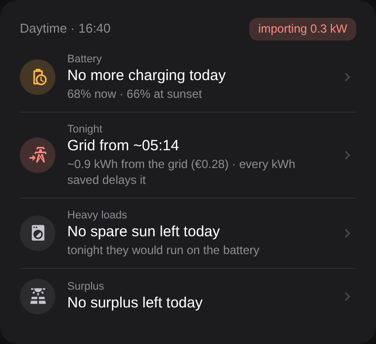

The day at a glance, worded for the time of day: the battery, tonight, today or
tomorrow, heavy loads, surplus and last night, each with a headline and why.
Tap a row to jump to the card that explains it.

**In the card editor**

- **Rows**: which rows, in the order you pick them.
- **Show the time and today's own power**: the line at the top.
- **Tapping a row**: jump to the card that explains it, or nothing.

<details>
<summary>YAML</summary>

```yaml
type: custom:solar-energy-insights-now
rows: [battery, tonight, next_day, loads, surplus, last_night]
header: true
tap: jump # or none
```

</details>

## Until sunrise

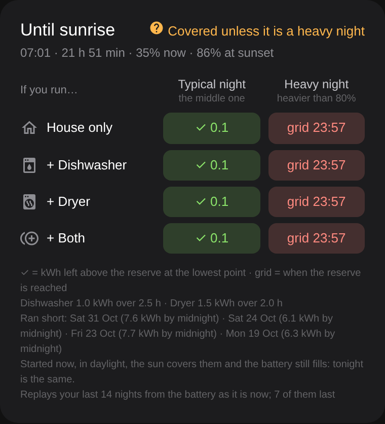

Your last nights replayed from the battery as it is now, for a typical night and
a heavy one: a tick and the kWh left above the reserve, or the time the grid
takes over. A row for each appliance shows what starting it tonight would leave.

**In the card editor**

- **Columns**: typical night, heavy night, or both.
- **Show the notes underneath**: the key, the appliances' figures and the
  nights that ran short.
- **Appliances you might start**: leave empty to use the
  [appliances added under the integration](#appliances-under-the-integration),
  or list some for this card only.
- **An appliance that may already be running**: an entity and its running
  state, so the card says it is already in the battery level.

<details>
<summary>YAML</summary>

```yaml
type: custom:solar-energy-insights-until-sunrise
columns: [typical, heavy]
footnotes: true
appliances: # optional: empty uses the integration's appliances
  - name: Dishwasher
    icon: mdi:dishwasher
    kwh: 1.0 # typical per run
    hours: 2.5
running: # optional
  entity: sensor.washing_machine_operation_state
  state: run
  name: Washing machine
```

</details>

## Best time to run

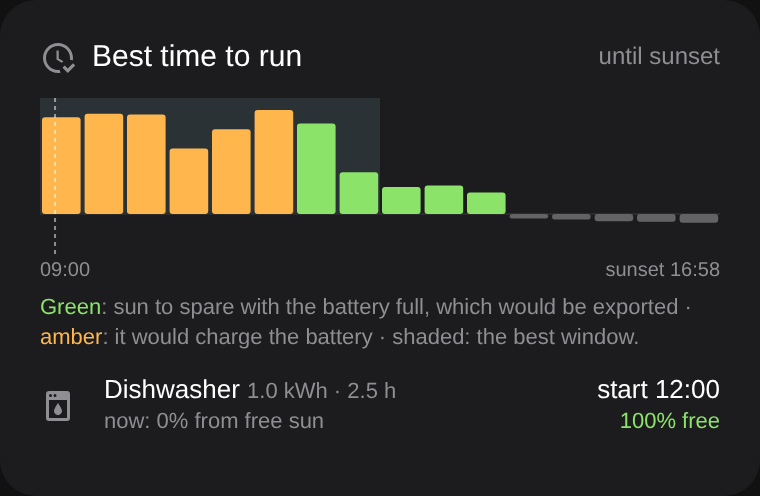

When spare sun is coming today, and the start that takes the most from it for
each appliance. Green is sun that would be exported with the battery full, and
so free; amber would charge the battery.

**In the card editor**

- **Show the chart of spare sun**
- **Appliances**: as for Until sunrise.

<details>
<summary>YAML</summary>

```yaml
type: custom:solar-energy-insights-best-time
chart: true
appliances: [] # empty: the integration's appliances
```

</details>

## Appliances

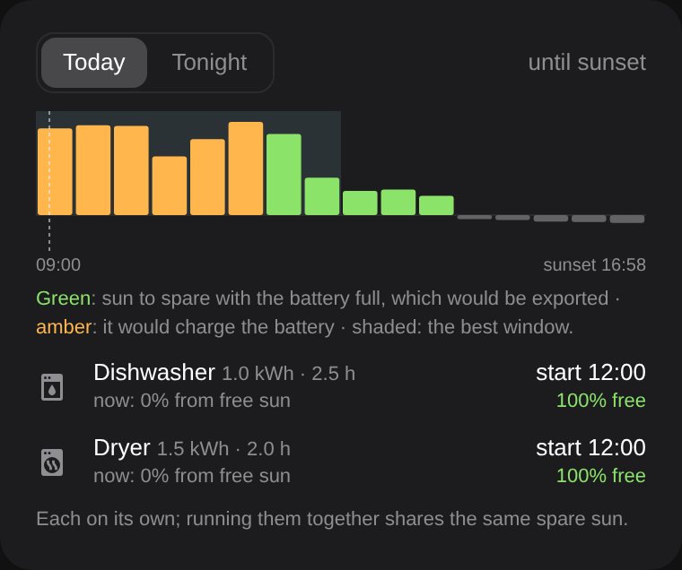

Best time to run and Until sunrise in one card, sharing one list of appliances,
with a Today / Tonight switch. It opens on today while the sun is up and on
tonight after sunset; a view picked by hand holds until that day or night is
over. The Now card's tonight row opens it on tonight.

**In the card editor**

- **Opens on**: today while the sun is up then tonight, always today, or always
  tonight.
- **Today: show the chart of spare sun**
- **Tonight: columns** and **Tonight: show the notes underneath**
- **Appliances** and **An appliance that may already be running**: as for
  Until sunrise.

<details>
<summary>YAML</summary>

```yaml
type: custom:solar-energy-insights-appliances
view: auto # or today, tonight
chart: true
columns: [typical, heavy]
footnotes: true
appliances: [] # empty: the integration's appliances
running: # optional, as for Until sunrise
```

</details>

### Appliances under the integration

Appliances are best added once, under the integration: **Settings › Devices &
services › Solar Energy Insights › Add appliance**. Every card without a list
of its own then shows them, and each gets a "Best start" sensor and a "Good time
to start" binary sensor for automations (the `start_appliance.yaml` blueprint
starts one when it is a good time).

Give an appliance its **energy counter**, such as its smart plug's. Its runs are
then learned from the counter, in place of the typical figures, and taken out of
the nights a run is added to, so tonight's run is not counted twice. Counters
that look like appliances are suggested when you add one, and under
**Settings › Repairs**.

## Can I trust the forecast?

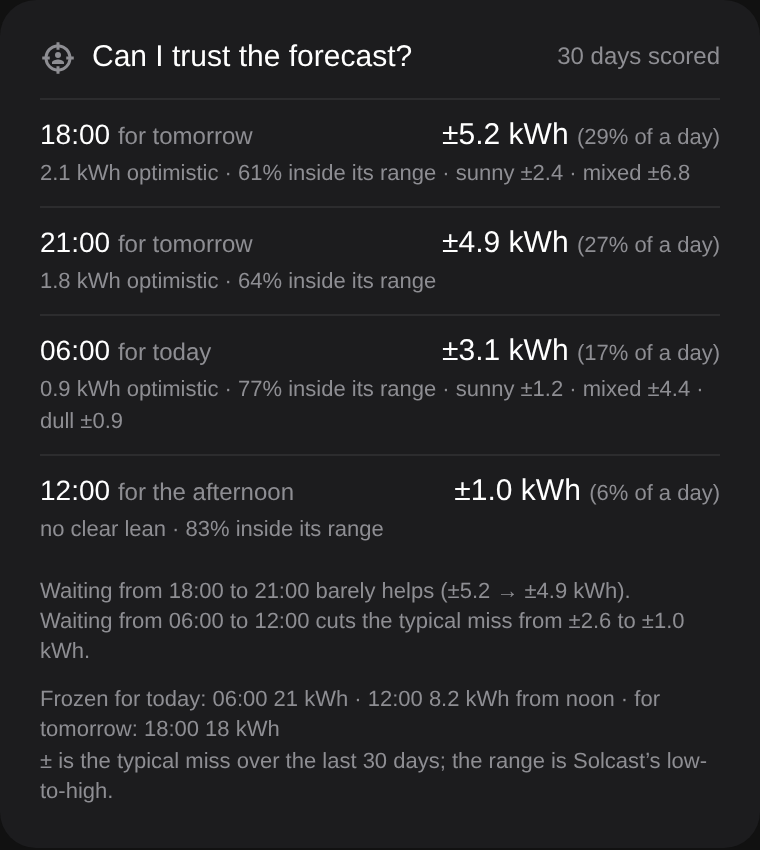

Solcast's forecast is frozen at 18:00, 21:00, 06:00 and 12:00 and scored against
what came: how far off it usually is at each, which way it leans, and how often
the day stayed inside its range.

**In the card editor**

- **Checkpoints**: which of the four to show.
- **Show the notes underneath**: what waiting buys, and today's frozen figures.

<details>
<summary>YAML</summary>

```yaml
type: custom:solar-energy-insights-forecast-trust
checkpoints: ["18:00", "21:00", "06:00", "12:00"]
footnotes: true
```

</details>

## Scenario lab

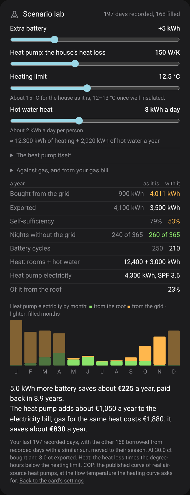

Your last year replayed with a bigger battery or a heat pump, against the house
as it is: what you would have bought, exported and saved. Needs the solar energy
counter, and for a heat pump an outdoor thermometer, in the integration's
options.

**In the card editor**

- **Extra battery to start from**, **Heat loss to start from** (0: no heat pump)
  and **Hot water heat per day**: where the sliders start.
- **Battery price per kWh**: for the payback.

<details>
<summary>YAML</summary>

```yaml
type: custom:solar-energy-insights-scenario-lab
extra_battery_kwh: 5
heat_loss_w_per_k: 0 # 0: no heat pump
hot_water_kwh_per_day: 6
battery_price_per_kwh: 400 # optional
```

</details>

## Solar moments

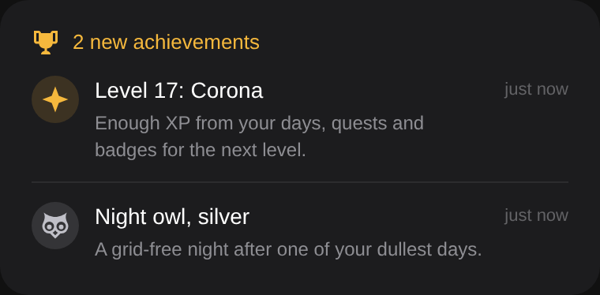

What was just achieved (a level, a badge tier, a record, a quest met, a month's
recap), each with a line on why, from when it happened until a day later.
Several at once, or one after another, each keep their own time. With nothing
new the card hides itself, so put it at the top of a view.

**In the card editor**

- **Show each for**: hours, 24 by default.
- **At most, before "+ more"**
- **Tap opens**: a dashboard path, such as your achievements view.

<details>
<summary>YAML</summary>

```yaml
type: custom:solar-energy-insights-moments
hours: 24
max: 3
navigation_path: solar-achievements # optional
```

</details>

## Solar level

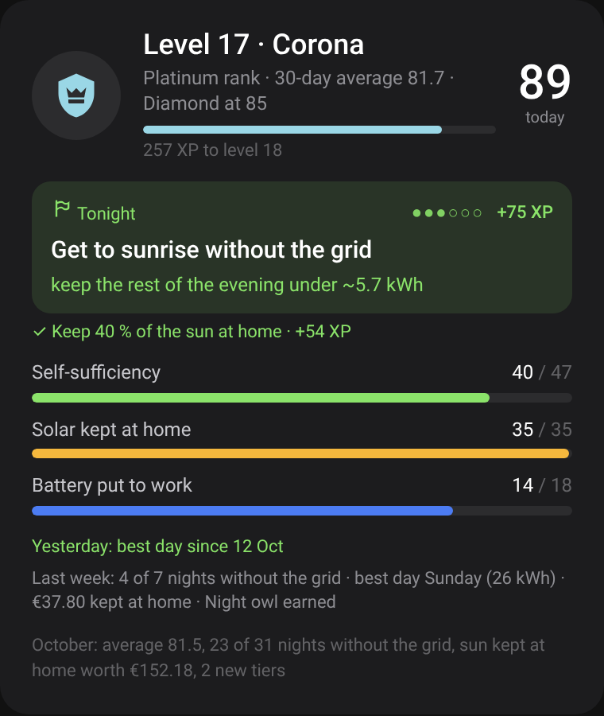

Your level and rank, today's score and what makes it up, and today's quest.
[How achievements work](achievements.md).

**In the card editor**

- **Show the quest**
- **Show yesterday and last week**

<details>
<summary>YAML</summary>

```yaml
type: custom:solar-energy-insights-level
quest: true
recap: true
```

</details>

## Solar streaks

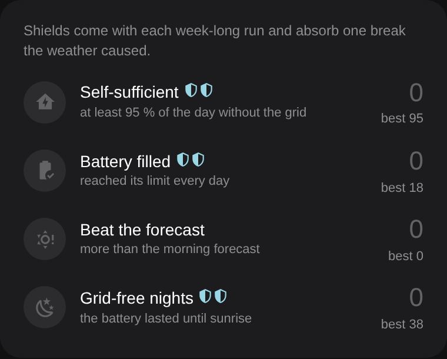

Your streaks, with the shields that absorb a break the weather caused. No
settings.

<details>
<summary>YAML</summary>

```yaml
type: custom:solar-energy-insights-streaks
```

</details>

## Solar records

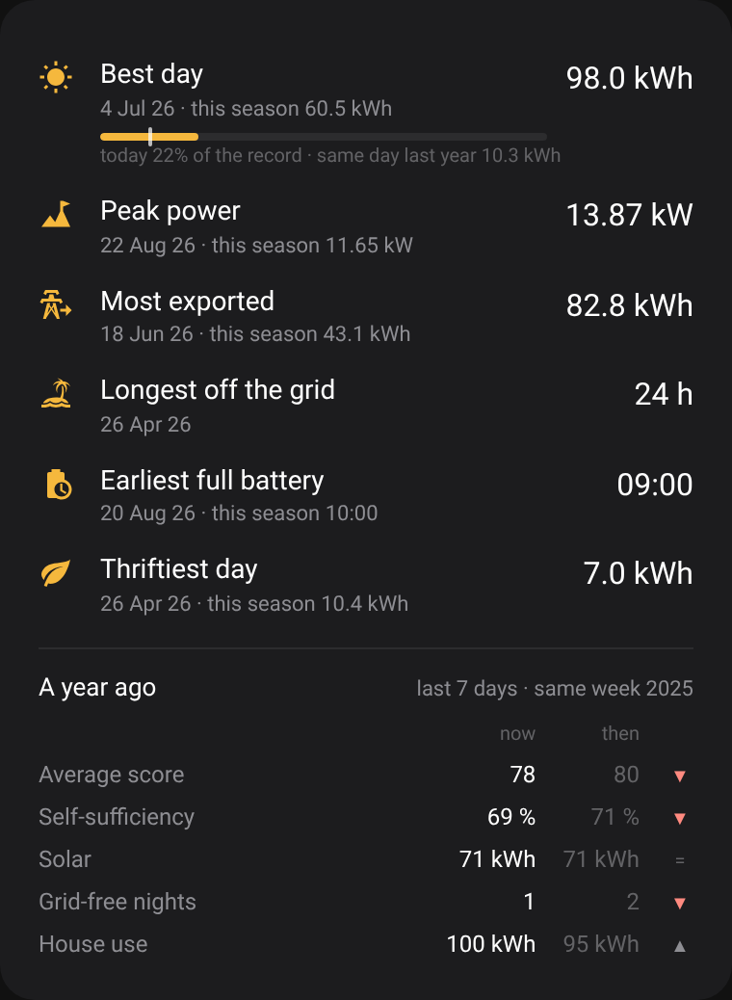

Your best days, all time and this season, and how today compares with the
record and with the same day last year. It ends with the last week against the
same week a year ago.

**In the card editor**

- **The last week against a year ago**: off hides that comparison.

<details>
<summary>YAML</summary>

```yaml
type: custom:solar-energy-insights-records
year_ago: true
```

</details>

## Solar badges

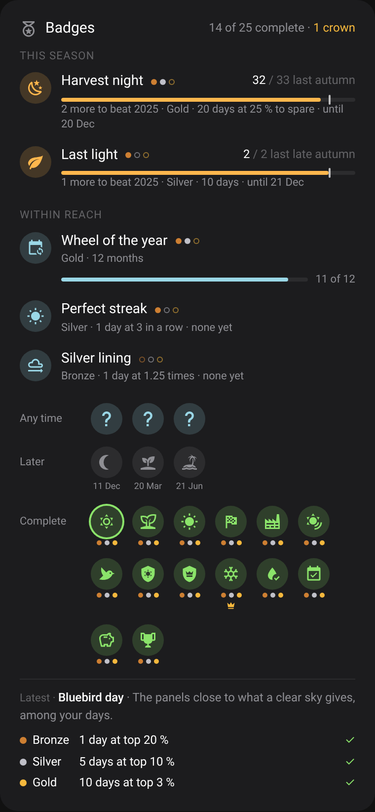

This season's badges first, each racing its last season with a tick where that
one ended, then badges within reach with what their next tier asks ("Silver · 5
days at 65 %"), any time, later in the year and complete. Tap one for each
tier's step, the seasons it was played and what follows it.

**In the card editor**

- **Sections**: which, in the order you pick them.

<details>
<summary>YAML</summary>

```yaml
type: custom:solar-energy-insights-badges
sections: [this_season, within_reach, any_time, later, complete]
```

</details>

## Colours

The cards follow your theme, light or dark. To change the status colours, see
[Card colours](reference.md#card-colours).

## Building your own

`sensor.solar_energy_insights_summary` holds what the Now card shows: `rows`,
each with a `label`, `main` (the headline), `detail` (up to two clauses), a
`tone` (`good`, `warn`, `bad`, `neutral`) and an `icon`. A Markdown card:

```yaml
type: markdown
content: >
  
  **{{ row.label }}:** {{ row.main }} · {{ row.detail | join(' · ') }}

  
```

A card of your own can be a target for the Now card's taps: put
`SolarDash.jumpMark(key)` in it, with `battery`, `sunrise`, `today` or
`forecast`. Before scrolling, the tap sends a `sei-jump` event on `window` with
the key in `detail.key`, so a card with views can open the one the row is about.

The other sensors are in the [reference](reference.md). For everything the
cards draw, the `solar_energy_insights/plan` WebSocket command returns the full
plan.

### History by week, month and year

The shipped script also provides `window.SolarPeriod`, for button-card and
apexcharts cards on a history page. Create two helpers: a dropdown
`input_select.solar_history_period` with `Day`, `Week`, `Month` and `Year`, and a
date `input_datetime.solar_day`. `SolarPeriod.view(hass, states, this)` returns the
selected period's totals with the previous period and the same period last year;
`SolarPeriod.series(hass, key)` and `SolarPeriod.profile(hass, key)` feed
apexcharts' `data_generator`. Pass a typical year, kWh per month, with
`SolarPeriod.setTypical([...])` to compare a year with it. To value days in €, pass the
price entities (ct/kWh) with `SolarPeriod.setPrices({ buy, sell, buyDefault,
sellDefault })`: each day then carries `v` (€ saved), `va` (not bought), `ve` (fed
in) and `vb` (spent) at that day's price. Prices come from the entity's long-term
statistics, else its recorded history, which the recorder keeps only for its purge
window.
